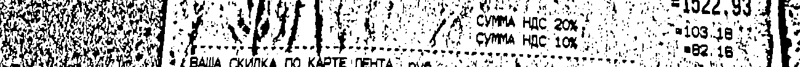
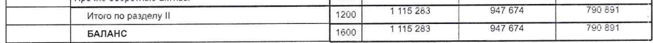
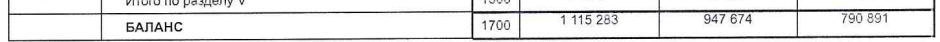
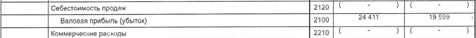

# Первичное распознавание русского текста: исправления и группа E

3 ноября 2026 года. Проверены прежние 60 случаев и новый комплект из десяти страниц.
Исходная версия для сравнения: `45908227be5cee1471fe998e3648d67a2276f066`.

На прежних 60 случаях прохождение выросло с 45 до 47. На новой группе — с 1 до 2 из 10, числовых полей с 19 до 24 из 58. Сложные новые чеки пока распознаются ненадёжно; один даёт пустой результат в обеих версиях. Исправлены отдельные общие ошибки обработки. Суммы и реквизиты по-прежнему нужно сверять с изображением.

## Что исправлено

- Поворот всей страницы проверяется до повторного поиска строк. Правильно стоящие русские строки больше не проходят безусловный отдельный поворот.
- Если ни одно направление не даёт достаточно уверенного чтения, доступен прежний запасной способ. Он сохраняет полные суммы, уверенные числовые слова и непустой текст. Его настройки отделены от основного распознавателя.
- Дополнительная обработка повёрнутых изображений получает слова и изображение в одном направлении. Результат возвращается в координаты оригинала. При ошибке исходные данные не остаются наполовину повёрнутыми.
- Слабое вспомогательное деление абзаца не отвергает совпадающие чтения двух сильных моделей. Удаление слабых отдельных следов шума требует такого согласия. Числа, знаки и места слов защищены.
- Подтверждённая строка, захваченная соседними текстовыми блоками, сохраняется один раз. Совпадение проверяется по полному тексту и наклонной полосе букв. Настоящие повторы на других строках, исходный текст PDF и числовые поля сохраняются.
- Несколько уверенно прочитанных горизонтальных русских строк подтверждают нормальное направление. Незнакомые названия товаров сами по себе не запускают три полных поворота. Прежний предел 180 секунд сохранён.
- Смесь похожих латинских и русских букв в известном слове всё равно вызывает проверку по изображению. Разные режимы одного Tesseract больше не считаются разными моделями при выборе числа.
- Отделение суммы чека от подписи сохраняет минус, включая настоящие возвраты.
- Плотный знак перед суммой сверяется с исходным изображением и независимыми чтениями. Подтверждённые значения и знаки сохраняются на своих местах при последующем чтении строки; остальные поля этим не фиксируются.
- При упорядочивании соседних фрагментов учтены полные координаты уверенно прочитанных слов. Это уменьшает влияние перекрывающихся пустых краёв рамок. Неполные, слабые или выходящие за рамку данные для этого не используются.

В новых правилах нет имён файлов, организаций, товаров или ожидаемых сумм. Числа и НДС не вычисляются для подстановки. Модели и зависимости не менялись, дообучения не было.

Первичное чтение осталось на прежнем `eslav`. Пробная замена на Medium Cyrillic ухудшила пробелы на неизменённом контрольном скане и отклонена. Вариант, который принудительно поворачивал шумный чек по нескольким словам, тоже отклонён.

## Сравнение

Документ проходит только при успехе всех его условий. Доля прошедших документов и доля правильных символов оценивают разные вещи.

| Группа | Все условия: до → после | Значения таблиц: до → после | Числовые поля: до → после | Текст в прежних пределах: до → после |
|---|---|---|---|---|
| Прежняя группа D | 3/10 → 4/10 | 95/95 → 95/95 | 38/48 → 39/48 | 7/13 → 10/13 |
| Прежняя группа C | 4/10 → 5/10 | 133/133 → 133/133 | 43/60 → 46/60 | 7/12 → 7/12 |
| Прежняя группа B | 10/10 (исх. 9/10) → 10/10 (исх. 9/10) | 81/81 → 81/81 | 19/19 → 19/19 | 15/15 → 15/15 |
| Предыдущая новая группа | 8/10 → 8/10 | 192/192 → 192/192 | 30/31 → 30/31 | 12/14 → 12/14 |
| Вторая исходная группа | 10/10 (исх. 8/10) → 10/10 (исх. 8/10) | 249/249 → 249/249 | 34/34 → 34/34 | 5/5 → 5/5 |
| Первая исходная группа | 10/10 (исх. 9/10) → 10/10 (исх. 9/10) | 117/117 → 117/117 | 12/12 → 12/12 | 5/5 → 5/5 |
| Новая группа E | 1/10 → 2/10 | 122/135 → 122/135 | 19/58 → 24/58 | 7/14 → 8/14 |

| Группа | Отличий в проверяемом тексте: до → после | Оценено символов: до → после |
|---|---:|---:|
| Прежняя группа D | 155 → 7 | 1314 → 1314 |
| Прежняя группа C | 49 → 49 | 462 → 462 |
| Прежняя группа B | 3 → 4 | 1777 → 1777 |
| Предыдущая новая группа | 41 → 41 | 1487 → 1487 |
| Вторая исходная группа | 2 → 2 | 985 → 985 |
| Первая исходная группа | 12 → 12 | 1617 → 1617 |
| Новая группа E | 91 → 87 | 1090 → 1090 |

Для групп B и двух исходных групп сохранены только ранее принятые поправки эталонов. Обозначение «исх.» показывает прохождение по первоначальным ответам. Оба набора оценок сохранены в JSON. Ответы, области, пределы ошибок и правила сравнения в этой работе не менялись.

Повторно проверена ранее принятая поправка старого чека: первоначальный ответ поля `vat-20` случая `receipt-grocery-mixed-vat` содержит 103.19, а на оригинале напечатано 103.18. Значение 103.18 уже записано в `russian_ocr_unseen/reference_adjudications.json` до этой работы. Обе версии программы читают 103.18. Первоначальная и ранее проверенная оценки сохраняются отдельно; новой поправки нет. Подтверждение и хеши — в `source-discrepancies.json`. Новая E для настройки не использовалась.

Фрагмент сохранён в исходных пикселях без увеличения и очистки. Число не вычислялось из итогов или ставки НДС. Права и источник оригинала указаны в прежнем комплекте `russian_ocr_unseen`.

Для прежних результатов отдельно проверено совпадение зафиксированного кода и моделей с началом этой работы; хеши отчётов сохранены в `baseline-report-provenance.json`.

Числовое поле проверяется в зафиксированной области и в экспортированном тексте. Это не доказывает правильную связь каждой подписи со значением: близкая повторяющаяся сумма может попасть в ту же область. Табличные значения проверяются в своих строках и физических столбцах. Проверка охватывает выбранные части документов.

Успешная проверка чисел не означает безошибочный текст всей строки. Названия товаров, знаки между ценой и количеством и пометки за пределами выбранных текстовых областей оцениваются только там, где для них заранее записан отдельный ответ.

## Аудиторское заключение из прежней группы D

| Область | Отличий до | Отличий после | Символов в эталоне |
|---|---:|---:|---:|
| `audit-heading` | 2 | 0 | 44 |
| `audited-statements` | 126 | 0 | 575 |
| `auditor-opinion` | 20 | 0 | 491 |

Прямое сравнение одинаковых участков показало ошибочные повороты на 180°: исчезали читаемые слова и искажались цифры. Наблюдения сохранены в `primary-causal-evidence.json`. Это примеры причины ошибки, а не отдельная оценка точности.

## PDF и фотографии отдельно

Счётчики ниже относятся к фактически оценённым текстовым областям. Ошибки выполнения перечислены отдельно в `assessment-coverage.json` и всегда означают непройденный случай. Полные знаменатели для полей и таблиц сохранены в основной таблице.

| Группа | Формат | Отличий в тексте: до → после | Оценено символов: до → после |
|---|---|---:|---:|
| Прежняя группа D | PDF | 148 → 0 | 1213 → 1213 |
| Прежняя группа D | Фотографии | 7 → 7 | 101 → 101 |
| Прежняя группа C | PDF | 0 → 0 | 131 → 131 |
| Прежняя группа C | Фотографии | 49 → 49 | 331 → 331 |
| Новая группа E | PDF | 8 → 4 | 996 → 996 |
| Новая группа E | Фотографии | 83 → 83 | 94 → 94 |

## Новая группа E

Шесть фотографий чеков, три страницы финансовой отчётности и страница аудиторского заключения: восемь новых оригиналов. Контроль включает 135 табличных значений, 58 числовых полей и 14 текстовых областей. Фотографии уже переведены издателем в чёрно-белый вид. Один чек подан боком без изменения исходного файла.

Выбор шести фотографий выполнен по заранее заданному правилу до их просмотра. Все шесть сохранены. Хеши отличаются от 199 прежних оригиналов и кандидатов; дополнительно проверено сходство изображений. Это новизна относительно наших проверок. Состав первоначального обучения сетей неизвестен.

Ответы и области записаны по изображениям до первого распознавания. Сначала зафиксирована и проверена программа на прежних документах. Затем сохранён первый результат E. После него тот же комплект прочитала исходная версия из неизменённого архива Git. Результаты E не использовались для изменения программы.

Парное сравнение показало пять новых прошедших числовых проверок и одну текстовую; новых потерь прежних проходящих проверок нет. Все 135 табличных оценок совпали между версиями. Полные изменения ячеек проверены отдельно: изменился только порядок слов одной подписи даты, числовые знаки и размеры таблиц сохранились. Подробности — в `e-comparison.json` и `e-full-table-changes.json`.

Длинный чек `receipt-visa-services` не завершился за 180 секунд ни в одной версии. После остановки обработки не осталось одной преобразованной страницы, поэтому исходная ошибка проверяющей программы — `ValueError: Each control case must convert exactly one page.`. Это пустой результат и провал всех его 14 числовых полей и текстовой области. Они включены в полные знаменатели 58 и 14, хотя исходные списки оценок этого случая пусты.

[Источники, выбор, ответы и команда повторения](../russian_ocr_holdout_20261103e/README.md). `evaluation-seal.json` хранит первоначальную фиксацию, `run-seal.json` — окончательную программу до первого запуска E, `baseline-run-seal.json` — исходную версию для парного сравнения.

Повторяющиеся формы чеков и три финансовые страницы одного файла связаны между собой. Небольшая группа не доказывает точность на произвольных документах.

### Ошибки ответов и пределы проверки E

После первого запуска при повторной сверке изображения найдена ошибка подготовки ответов: в трёх ячейках записано `1 115 238`, а на скане напечатано `1 115 283`. Это строки 1200 и 1600 активов, строка 1700 обязательств. Программа прочитала эти три числа верно. Ответы и первоначальные отрицательные оценки сохранены; обе версии сравниваются с тем же неизменённым файлом. Эти три несовпадения входят в исходный счёт основной таблицы, но не являются ошибками распознавания. Сведения и хеши — в `e-source-discrepancies.json`.

Ещё одно ограничение проверки: полный прочерк в типографских скобках `( - )` не принимается неизменённым сравнением как эквивалент ответа `-`. В строке 2210, во втором числовом столбце, это даёт отрицательную оценку при сохранённом знаке. Фрагменты скобок, пропущенные прочерки и потерянные минусы других ячеек остаются реальными ошибками. Проверяющая программа не исправлялась после первого запуска.

Эти фрагменты вырезаны без увеличения и очистки из заранее сохранённого изображения PDF с масштабом 1.8. Оригинал PDF не изменён. Повторная сверка не использовалась для изменения программы.

Прохождение заключения по текстовому допуску не означает правильный идентификатор: в основном абзаце осталась русская буква `о` вместо одного нуля ОГРН и пропущен пробел в `приложений к`. Заголовок и мнение совпали точно. Такой результат требует сверки реквизитов.

## Оставшиеся ошибки

Ниже перечислены все непройденные числовые и текстовые проверки прежних групп и новой E. Полные исходные строки, оценки и ошибки таблиц сохранены в соответствующих JSON.

| Группа / случай | Проверка | Ожидалось | Что не прошло |
|---|---|---|---|
| D / `receipt-order-222-no-vat` | `paid` | 89.00 | -89.00 |
| D / `receipt-engels-torg` | `vat-caption-and-amount` | Предел 2.0% | Отличий: 3 на 19 символов |
| D / `receipt-canteen-breakfast` | `syrniki-price` | 99.00 | 99.002, 198.00 |
| D / `receipt-canteen-breakfast` | `syrniki-quantity` | 2 | 99.002, 198.00 |
| D / `receipt-canteen-breakfast` | `vat-rate-5` | 5 | 16.7 |
| D / `receipt-canteen-breakfast` | `vat-amount-5` | 16.77 | 16.7 |
| D / `receipt-canteen-breakfast` | `paid` | 352.00 | 52.00 |
| D / `receipt-canteen-breakfast` | `receipt-heading` | Предел 2.0% | Отличий: 2 на 12 символов |
| D / `receipt-canteen-three-eggs` | `egg-price` | 35.00 | 5.00, 3 , 105.00 |
| D / `receipt-sideways-business-lunch` | `lunch-quantity` | 1 | -419.0, 10 , 419.01, 419 |
| D / `receipt-sideways-business-lunch` | `vat-rate-5` | 5 | 419 |
| D / `receipt-clinic-no-vat` | `vat-exemption` | Предел 2.0% | Отличий: 2 на 17 символов |
| C / `receipt-lenta-two-vat-rates` | `vat-rate-20` | 20 | 2, -1.50 |
| C / `receipt-lenta-two-vat-rates` | `vat-amount-20` | 1.50 | 2, -1.50 |
| C / `receipt-lenta-two-vat-rates` | `sale-heading` | Предел 5.0% | Отличий: 18 на 31 символов |
| C / `receipt-lenta-two-vat-rates` | `total-payment-vat` | Предел 5.0% | Отличий: 18 на 100 символов |
| C / `receipt-lenta-handwritten-overlay` | `bread-last-sum` | 239.98 | 119,99, 21, 239.38, 102 |
| C / `receipt-lenta-handwritten-overlay` | `vat-amount-10` | 52.00 | 10, 00 |
| C / `receipt-lenta-handwritten-overlay` | `sale-heading` | Предел 5.0% | Отличий: 5 на 31 символов |
| C / `receipt-lenta-handwritten-overlay` | `total-payment-vat` | Предел 5.0% | Отличий: 5 на 80 символов |
| C / `receipt-aromatny-mir` | `third-item-vat` | 15.00 | 4600682042303 , 0.45, 1 , 89.99, 4710 , 2015.00, 4600682042303 , 0 , 0.45 |
| C / `receipt-aromatny-mir` | `before-discount` | 399.96 | 1399.96 |
| C / `receipt-aromatny-mir` | `total` | 355.96 | 3.96 |
| C / `receipt-aromatny-mir` | `receipt-heading` | Предел 5.0% | Отличий: 1 на 12 символов |
| C / `receipt-canteen-507` | `total` | 507.00 | -507, 00 |
| C / `receipt-canteen-507` | `vat-rate-5` | 5 | 24.15 |
| C / `receipt-canteen-discount` | `container-price` | 13.50 | 1 , 13.54, 54.00, 5 |
| C / `receipt-canteen-discount` | `container-quantity` | 4 | 1 , 13.54, 54.00, 5 |
| C / `receipt-canteen-discount` | `soup-container-sum` | 27.00 | 1 , 13.50, 2 , -27.00, 57 |
| C / `receipt-canteen-discount` | `rice-sum` | 356.40 | 1, 89.10, 4 , 6.40, 57 |
| C / `receipt-canteen-discount` | `vat-rate-5` | 5 | 50.61 |
| NEWEST / `receipt-appliance-vat-20` | `card` | 39617.00 | Число не найдено |
| NEWEST / `receipt-appliance-vat-20` | `appliance-total-and-vat` | Предел 3.0% | Отличий: 23 на 37 символов |
| NEWEST / `photo-passport-open` | `passport-issue-and-expiry` | Предел 3.0% | Отличий: 15 на 21 символов |
| E / `vladimir-assets` | Таблица | Значения в своих ячейках | Несовпадений с неизменёнными ответами: 3; подробности в JSON |
| E / `vladimir-liabilities` | Таблица | Значения в своих ячейках | Несовпадений с неизменёнными ответами: 1; подробности в JSON |
| E / `vladimir-results` | `results-heading` | Предел 2.0% | Отличий: 2 на 41 символов |
| E / `vladimir-results` | Таблица | Значения в своих ячейках | Несовпадений с неизменёнными ответами: 9; подробности в JSON |
| E / `receipt-soup-no-vat` | `soup-price` | 470.00 | 350 , 470.001 |
| E / `receipt-soup-no-vat` | `soup-quantity` | 1 | 350 , 470.001 |
| E / `receipt-soup-no-vat` | `paid` | 470.00 | 4 |
| E / `receipt-soup-no-vat` | `vat-exemption` | Предел 5.0% | Отличий: 43 на 17 символов |
| E / `receipt-visa-services` | Выполнение | Успешная обработка | Ошибка выполнения; контроль случая не пройден |
| E / `receipt-six-dishes-vat5` | `pork-price` | 189.00 | 1 , 9 , 189.01 |
| E / `receipt-six-dishes-vat5` | `salad-price` | 135.00 | 15.00, 1 |
| E / `receipt-six-dishes-vat5` | `salad-sum` | 135.00 | -1.00 |
| E / `receipt-six-dishes-vat5` | `cauliflower-price` | 125.00 | 125.001 |
| E / `receipt-six-dishes-vat5` | `compote-price` | 50.00 | 50.01 |
| E / `receipt-six-dishes-vat5` | `total` | 907.00 | -907.00 |
| E / `receipt-six-dishes-vat5` | `vat-amount-5` | 43.19 | 5, -43.19, 907.00 |
| E / `receipt-six-dishes-vat5` | `receipt-heading` | Предел 5.0% | Отличий: 24 на 12 символов |
| E / `receipt-sideways-two-dishes` | `borscht-price` | 99.00 | 8 .11 |
| E / `receipt-sideways-two-dishes` | `borscht-quantity` | 1 | 8 .11 |
| E / `receipt-sideways-two-dishes` | `borscht-sum` | 99.00 | 198, 00 , -99.00, 990  |
| E / `receipt-sideways-two-dishes` | `rice-price` | 99.00 | 8 |
| E / `receipt-sideways-two-dishes` | `rice-quantity` | 1 | 8 |
| E / `receipt-sideways-two-dishes` | `rice-sum` | 99.00 | 198, 00 , -99.00, 990  |
| E / `receipt-sideways-two-dishes` | `vat-rate-5` | 5 | 56462 , 4, 0, 57 , 18.10, 2516, 20 1496761955 7825 , 0010 199155 |
| E / `receipt-sideways-two-dishes` | `vat-amount-5` | 9.43 | 198, 00 , -99.00, 990 198.000 |
| E / `receipt-sideways-two-dishes` | `receipt-heading` | Предел 5.0% | Отличий: 14 на 12 символов |
| E / `receipt-beer-no-vat` | `total` | 860.00 | -860.00 |
| E / `receipt-beer-no-vat` | `paid` | 860.00 | -860.00 |
| E / `receipt-beer-no-vat` | `receipt-heading` | Предел 5.0% | Отличий: 2 на 12 символов |

## Проверка изменений вне выбранных ответов

Дополнительно просмотрены все изменившиеся ячейки прежних таблиц. Это не меняет заранее записанные ответы и не превращает непроверенный текст в подтверждённый. Полные отличия сохранены в `full-table-changes.json`, разбор — в `full-table-review.json`.

- Все 867 выбранных значений прежних таблиц сохранились. Подписи строк полностью безошибочными не стали: остаются похожие латинские и русские буквы, лишние прописные буквы и перестановки слов.
- Есть ухудшения вне выбранных числовых ответов: перестановка слов в подписи итога раздела II и в одной длинной подписи движения денег; в трёх подписях баланса «Россетей» появились пропуски букв. Рядом сохранены исходные и новые варианты. Другие подписи, в том числе банковские, стали читаться лучше.
- На дипломе пропала одна закрывающая кавычка: было 0 отличий, стало 1 на 152 символа. Это укладывается в прежние 2%, но точное совпадение ухудшилось.
- На фотографии документа в двух ячейках неполный вертикальный фрагмент «2» изменился на «0». На источнике стоит «02»; полное значение не воспроизведено ни до, ни после. Выбранная проверка текста выдающего органа не проверяет всю серию документа.
- Верная сумма хлеба 224.97 не делает всю строку верной: остаются «74.99-3» и «НДС 102» вместо правильных знаков. Проверка отдельных чисел не засчитывается как проверка всей товарной строки.

Все первоначальные неуспешные попытки сохранены локально; их хеши перечислены в `local-artifacts.json`. Они не заменяют окончательные оценки. Полные исходные фотографии и PDF не включены в этот каталог.

## Проверка воспроизводимости

- Одна зафиксированная программа, те же 36 файлов моделей и те же зависимости для окончательных проверок. Исходная версия E использует отдельный архив кода из указанного коммита; место загрузки каждого Python-модуля проверено.
- CPU, четыре потока, прежний предел 180 секунд на документ. При распознавании соединения Python запрещены. Захват сетевого трафика не проводился.
- Контрольные суммы оригиналов, ответов, областей, проверяющих программ и моделей проверены до и после выполнения. Контрольные суммы кода перечислены в фиксациях.
- В `assessment-coverage.json` указаны полные зафиксированные знаменатели, в том числе для возможных ошибок выполнения. Ни одна такая ошибка не засчитывается как успех.

| Проверка | Успешно | Пропущено |
|---|---:|---:|
| `unit-tests` | 774 | 15 |
| `cli-tests` | 12 | 0 |
| `threaded-tests` | 2 | 0 |
| `synthetic-tests` | 8 | 0 |

Пропуски относятся к недоступным дополнительным движкам и платформенным проверкам. Проверки русского распознавания с локальными моделями выполнены. Результаты проверки кода и окончательных правил оформления хранятся рядом с этим отчётом.

Dima Mak · ub3dqy
