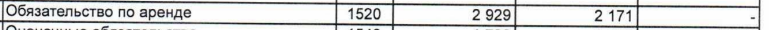

# Чеки: суммы, НДС, сохранение текста и новая группа F

4 ноября 2026 года. Исходная версия сравнения: `3685f3ab070e1ab804328340dbafd4d5c25d8e4b`.

Длинный чек E теперь даёт текст, числовые проверки прежних документов улучшились с **204/262 до 231/262**. Но надёжного чтения произвольных новых фотографий пока нет: первый прогон F дал **37/70 числовых полей** и **2/10 случаев** по всем условиям. Это результат частичного улучшения, а не готовность к автоматическому вводу сумм без сверки.

## Что изменено

- Кассовый документ с несколькими подтверждёнными признаками больше не отправляется на обработку оглавления. Восстановлена обработка длинного чека, который раньше не давал ни одной страницы за настроенные 180 секунд. Настоящие таблицы и готовый текст PDF сохраняют прежний путь обработки.
- Цена и количество повторно читаются из полной области напечатанного выражения. Высокая уверенность первого чтения сама по себе не запрещает проверку. Для замены нужны согласные чтения разных распознавателей; новый знак умножения дополнительно проверяется по пикселям.
- Повреждённая сумма сверяется со всей найденной областью числа. Сохранившиеся цифры и десятичные разряды защищены. Разделённые части одной суммы соединяются только в пределах подтверждённой исходной строки.
- Знак «=» перед суммой проверяется по изображению, включая соприкасающиеся и неравномерно напечатанные черты. Настоящие минусы и противоречащие уверенные чтения блокируют замену. Итоги и НДС не вычисляются для подстановки.
- Подтверждённая запись «цена × количество» сохраняется целиком при последующих чтениях: вместе со знаком, точностью количества, положением в строке и проверенной единицей измерения. В ходе разработки найдена и устранена потеря знака умножения, которую одна проверка чисел не обнаруживала.
- Для узких повёрнутых строк восстановлено направление, в котором установленный распознаватель действительно читал обрезку. Слова получают то же направление, что и их строка. Исходные точки на фотографии не перемещаются. Высокие узкие области больше не склеиваются как обычные горизонтальные соседи.

В правилах нет имён файлов, организаций, товаров или ожидаемых сумм. Веса нейросетей, зависимости, прежние ответы, области и допустимые ошибки проверки не менялись. Дообучения не было.

## Повтор прежних 70 случаев

| Группа | Все условия до → после | Числовые поля до → после | Табличные значения до → после |
|---|---|---|---|
| E | 2/10 → 2/10 | 24/58 → 49/58 | 122/135 → 122/135 |
| D | 4/10 → 4/10 | 39/48 → 39/48 | 95/95 → 95/95 |
| C | 5/10 → 5/10 | 46/60 → 48/60 | 133/133 → 133/133 |
| B | 10/10 → 10/10 | 19/19 → 19/19 | 81/81 → 81/81 |
| Предыдущая новая | 8/10 → 8/10 | 30/31 → 30/31 | 192/192 → 192/192 |
| Вторая исходная | 10/10 → 10/10 | 34/34 → 34/34 | 249/249 → 249/249 |
| Первая исходная | 10/10 → 10/10 | 12/12 → 12/12 | 117/117 → 117/117 |
| **Всего** | **49/70 → 49/70** | **204/262 → 231/262** | **989/1002 → 989/1002** |

Сводные оценки используют только ранее принятые поправки ответов старых групп. По первоначальным ответам, без этих поправок: **45/70 → 45/70 случаев, 202/262 → 229/262 полей, 984/1002 → 984/1002 табличных значений**. Оба набора оценок сохранены. Новых поправок для повышения результата нет.

Непустых результатов стало **70/70 вместо 69/70**. Длинный чек `receipt-visa-services` теперь содержит 1206 символов и проходит **13/14 числовых проверок**; неоднозначная товарная цена и повреждённый заголовок остаются. На чеках E с супом, шестью блюдами и пивом числовые поля дали соответственно **6/6, 15/15 и 6/6**. На боковом чеке E заголовок стал точным, но числовых полей по-прежнему только **2/10**.

Все ранее проходившие выбранные проверки чисел, таблиц и текста сохранены. Полные извлечённые таблицы всех 70 случаев совпали с исходной версией; это не только сравнение выбранных ячеек. У последних трёх старых групп совпали также все 30 полных текстовых выгрузок.

Текст в прежних пределах: **62/78 → 63/78 областей**. Общий сырой счёт отличий: **202/8732 → 219/8751 символов**. Покрытие выросло: теперь оценивается прежде отсутствовавший заголовок длинного чека, который добавляет 28 отличий на 19 символов ответа. Отдельно на одинаковых 77 ранее оценённых областях: **202 → 191 отличие на 8732 символах**. Этот дополнительный счёт не заменяет полные оценки и не скрывает ошибки восстановленного чека.

Две текстовые области E стали хуже по сырому счёту: подпись НДС на чеке с супом **43 → 44 отличия**, заголовок чека с шестью блюдами **24 → 26**. Их заранее заданные прямоугольники пересекают соседнюю товарную печать; проверка захватывает полную найденную строку. На исходных изображениях также проверены напечатанные точки заголовка пивного чека и неоднозначный знак товарной цены длинного чека. Ответы и исходные отрицательные оценки сохранены. [Наблюдения и фрагменты источников](source-text-controls.json).

Есть ухудшение вне выбранных проверок: на старом чеке `receipt-grocery-discount-vat20` подпись **«ФП»**, ранее прочитанная как «оП», исчезла; сами цифры `3748306580` сохранены. Изменился также порядок отдельных фрагментов на нескольких фотографиях. Поэтому отсутствие потерь выбранных проверок не означает отсутствия любых ошибок и ухудшений текста. [Все изменения полных выгрузок](export-changes.json).

В E сохранены три ранее найденные ошибки числовых ответов: на скане `1 115 283`, в ответах `1 115 238`. Они входят в неизменённый сырой счёт таблиц. Другие несовпадения, включая пропуски прочерков и фрагменты скобок, не объявляются ошибками ответов. [Исходная сверка E](../russian_ocr_primary_20261103/e-source-discrepancies.json).

## Первый прогон новой группы F и парное сравнение

Шесть фотографий чеков и четыре страницы двух сканированных PDF, всего восемь оригиналов. Проверяются **91 табличное значение, 70 числовых полей и 12 текстовых областей**. Среди полей есть скидка с настоящим минусом и НДС 5%, 10% и 20%. Три фотографии сильно повёрнуты. Издатель уже перевёл фоточеки в чёрно-белый вид.

Сначала зафиксированы состав, ответы и области, затем окончательная программа проверена на прежних 70 случаях. После этого сохранён первый прогон F. Исходная версия извлечена из указанного архива Git и прочитала те же файлы с теми же моделями, настройками и оценщиком. По результатам F программа и ответы не менялись.

| Проверка F | Исходная версия | Первый прогон исправлений |
|---|---:|---:|
| Все условия случая | 2/10 | 2/10 |
| Непустой результат | 10/10 | 10/10 |
| Числовые поля в области и выгрузке | 38/70 | 37/70 |
| Табличные значения, сырой счёт | 88/91 | 88/91 |
| Текст в прежних пределах | 5/12 | 5/12 |
| Отличия / символы выбранных текстов | 299/1320 | 299/1320 |

| Новый случай | Числовые поля до → после | Табличные значения после | Текстовые области в допуске после |
|---|---|---|---|
| `primorye-assets` | — | 18/18 | 1/1 |
| `primorye-liabilities` | — | 30/33 | 1/1 |
| `primorye-targeted-funds` | — | 40/40 | 1/1 |
| `mariel-independent-audit` | 1/1 → 1/1 | — | 1/3 |
| `receipt-grocery-vat10` | 14/19 → 14/19 | — | 0/1 |
| `receipt-bacon-vat5` | 4/7 → 4/7 | — | 0/1 |
| `receipt-four-dishes-vat5` | 2/17 → 2/17 | — | 0/1 |
| `receipt-business-lunch-vat5` | 7/10 → 6/10 | — | 1/1 |
| `receipt-business-mini-vat5` | 3/7 → 3/7 | — | 0/1 |
| `receipt-craft-shop-vat20` | 7/9 → 7/9 | — | 0/1 |

На F нет новых прошедших выбранных проверок. Сырой счёт теряет одно поле `business-lunch-quantity`: раньше в его область попадало выражение **145.00×1 из соседнего товара**. После разделения строк оно больше не делает проверку количества первого товара успешной. В обеих полных выгрузках сохранены `145.00*1` и ошибочное `419.01`; правильное выражение первого товара не восстановлено ни в одной версии. Эта отрицательная оценка оставлена, а причина записана в [сверке поля](f-field-regression-review.json).

Все полные таблицы F совпали; восемь полных текстов также совпали, два повёрнутых чека изменили порядок фрагментов и отдельные подписи. Это не доказательство общего улучшения текста. Все 57 изменений этих двух текстов просмотрены и сохранены вместе с изменениями прежних групп в [обзоре полных выгрузок](export-review.json).

В новом заключении номер ОГРН прочитан верно, но в двух абзацах осталось **188/642 и 75/490 отличий**. Наблюдаются перестановки фрагментов, пропуски и похожие латинские буквы. На чеках остаются слитые цена и количество, неверные знаки сумм, потерянные ставки и суммы НДС, ошибки цифр и текста. Например, в наклонённом чеке F четыре товарных выражения не восстановлены, а итог и оплата не найдены в выбранных областях. Все отрицательные оценки и непустые, но ошибочные результаты сохранены в [первом отчёте F](new-f-first.json).

### Ошибка подписи в ответе F

После первого запуска при сверке изображения обнаружена неточная подпись строки обязательств: в ответе **«Обязательства по аренде»**, на выбранной строке скана **«Обязательство по аренде»**. Извлечённая таблица содержит исходную подпись и значения `2929`, `2171`, `-`. Из-за несовпадения подписи строгая проверка не сопоставила строку и записала три отрицательные оценки. В другом разделе скана действительно есть подпись во множественном числе, но с другими значениями.

Сырой результат **88/91** и зафиксированные ответы оставлены без изменений. Это не три доказанные ошибки распознавания чисел. Новый пересчитанный процент вместо исходного результата не вводится. [Сверка, хеши и границы фрагмента](f-source-discrepancies.json).



Фрагмент вырезан из заранее сохранённого изображения страницы 3 без увеличения и очистки. Оригинал PDF не изменён.

### Как выбраны новые документы

Шесть фотографий выбраны до просмотра по шести минимальным хешам с фиксированной строкой выбора среди неиспользованных файлов закреплённого открытого набора. Все шесть первоначальных фотографий оставлены. Разметка издателя не загружалась. У восьми оригиналов новые SHA256 относительно 207 прежних физических файлов; дополнительно проверено сходство фотографий. PDF взяты с сайтов организаций, на выбранных страницах нет готового текста. Один загруженный PDF исключён до распознавания, потому что оказался обычным документом с текстовым слоем.

До первого распознавания по исходным изображениям уточнены области и граница одного заголовка; исходный и окончательный хеши записаны. Четыре неоднозначные дробные цены магазина рукоделия исключены заранее; их количество, итог, оплата и НДС остались в проверке. Значения не вычислялись из соседних строк. [План, источники, ответы и фиксация](../russian_ocr_holdout_20261103f/README.md).

Это новые оригиналы для наших запусков. Изображения просматривались при подготовке ответов до окончательных исправлений программы, поэтому проверка не была полностью слепой для разработки. Её прогнозы при изменении программы не использовались. Новизна относительно обучения нейросетей неизвестна. Повторяются формы чеков; три финансовые страницы относятся к одному файлу. Десять страниц не доказывают качество на любых документах.

## Проверки программы и неизменность условий

- 44 затронутых модуля проверок: **904 пройдено, 15 пропущено**.
- Проверки русского профиля командной строки: **12 пройдено**.
- Проверки завершения обработки при ошибке и превышении времени: **2 пройдено**.
- Полное распознавание искусственных русских сканов с текстом и таблицами: **8 пройдено**.
- Обязательные локальные проверки выполнены через `uv run --no-sync prek run --files ...`: формат, правила кода, типы, связи модулей, конфликты и предел 1500 строк. Команда `make` на этом компьютере недоступна; выполнен тот же набор проверок проекта.
- Проверены все относящиеся к задаче изменённые файлы, включая исключённые из выбора Open Code Review тесты, данные и документацию. Окончательный обзор включает код, проверки, источники и все опубликованные оценки; результат сверяется до публикации.

Сверены **343 файла программы, 36 файлов моделей, 68 прежних файлов ответов, настроек и оценщика** и восемь файлов новой группы, зафиксированных до её первого распознавания. Загруженные части исходной версии действительно взяты из архива Git. Версии девяти пакетов, настройки распознавания, исходники, ответы и оценщик совпадают между сравниваемыми запусками. Настройки: процессор, четыре потока, 180 секунд на документ. Это настроенный предел; фактическое время каждого случая сохранено в отчётах.

Доля полностью прошедших случаев не равна точности символов. Проверяются выбранные части документов. Числовая проверка требует значение в заданной области и выгрузке; она не доказывает правильную связь каждой подписи с суммой. При повторяющихся подписях оценщик выбирает наиболее совпадающую строку. Прямоугольник наклонной строки может включать соседнюю печать. Прохождение текстового допуска также не подтверждает правильность всех реквизитов: в заключении E по-прежнему есть буква вместо нуля ОГРН.

Полные изменения выгрузок просмотрены отдельно от выбранных ответов, но сплошной расшифровки каждой страницы для посимвольной оценки нет. Неизменность моделей не делает их чтение безошибочным. Новая группа показывает оставшиеся ограничения; программа пока требует проверки важных чисел по изображению.

## Повторение

Скачайте точные оригиналы по `sources.json` соответствующей группы и сверьте SHA256. Модели и установка русского профиля описаны в [руководстве](../../../docs/usage/russian_ocr.md).

```powershell
$env:PYTHONUTF8 = '1'
$env:PYTHONIOENCODING = 'utf-8'
uv run --no-sync python -c 'from pathlib import Path; import scripts.qualify_real_russian_ocr as q; q.FIXTURES=Path("tests/data/russian_ocr_holdout_20261103f"); q.main()' --sources output/russian-ocr-holdout-2026-11-03f/sources --artifacts-path model_artifacts/ru --output output/f-reproduce-20261104
```

Папка результата должна быть новой. Код завершения 1 у оценщика означает, что часть условий не пройдена. Для старых B и двух исходных групп при повторении сравнительных оценок нужен прежний `--use-source-review`; исходные оценки при этом сохраняются отдельно.

- [Сводные счётчики и потери выбранных проверок](summary.json), [полное парное сравнение](comparison.json).
- [Первый F](new-f-first.json), [F на исходной версии](new-f-baseline.json), отдельные файлы `*-before.json` и `*-after.json` для всех семи прежних групп.
- [Все изменения таблиц](table-changes.json), [все изменения полных текстов](export-changes.json).
- [Проверка выполнения и происхождения исходных результатов](verification.json), [состав программы, моделей и ответов](runtime-inventory.json), [условия сравнения](comparison-conditions.json).
- [Фиксация перед новым прогоном](pre-f-gate.json), [первый запуск F](../russian_ocr_holdout_20261103f/run-seal.json), [исходная версия F](../russian_ocr_holdout_20261103f/baseline-run-seal.json).

Исходные полные отчёты и выгрузки сохранены локально в `output/russian-ocr-receipts-2026-11-03`. Опубликованные выбранные оценки сверены с ними без удаления неудачных полей и ошибок выполнения; хеши полных отчётов записаны в каждом файле.
